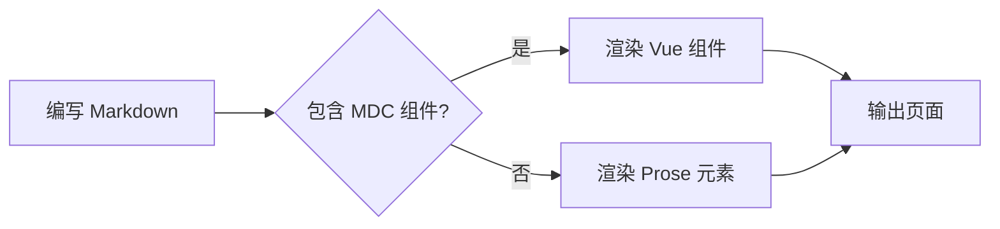
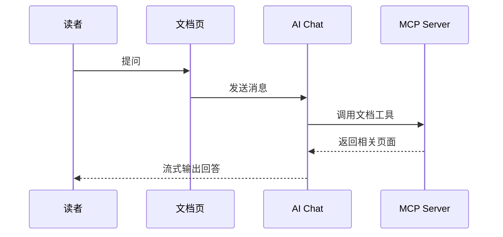
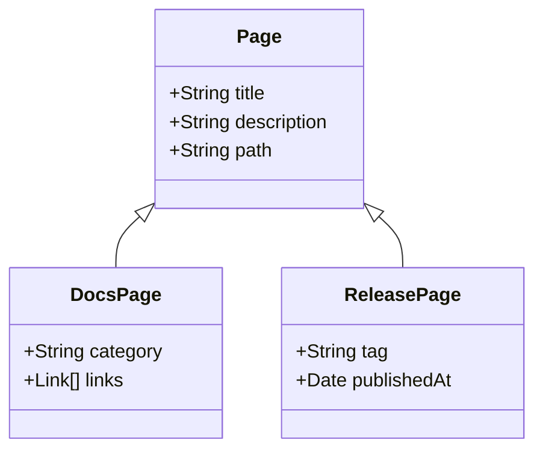
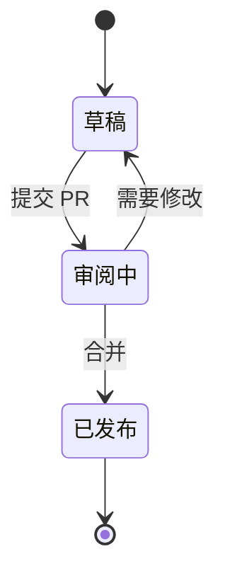
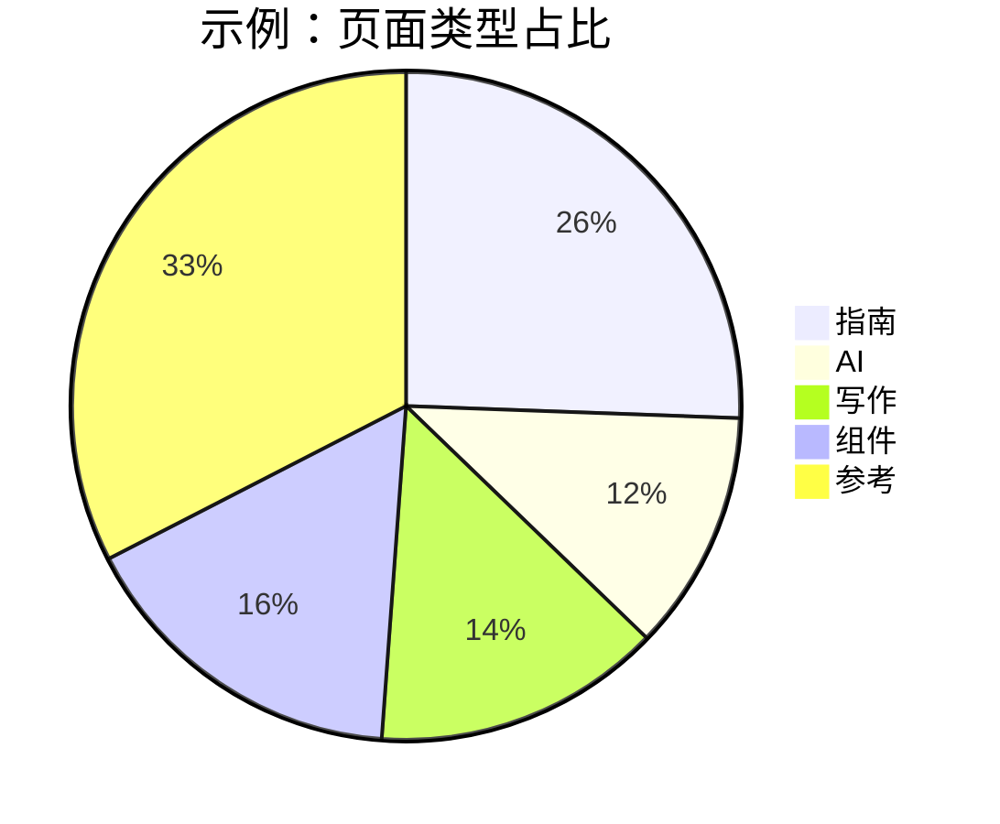
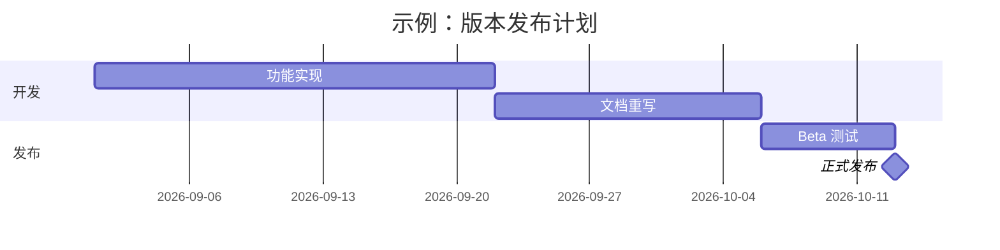
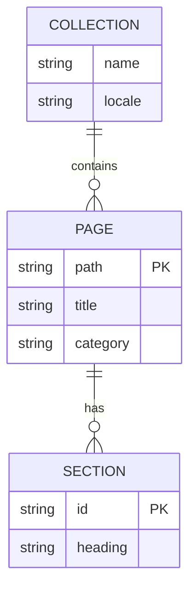

## 启用

Mermaid 默认关闭。

::steps{level="3"}
### 安装依赖

  ::code-group
  ```bash [pnpm]
  pnpm add mermaid dompurify
  ```

  ```bash [npm]
  npm install mermaid dompurify
  ```

  ```bash [yarn]
  yarn add mermaid dompurify
  ```

  ```bash [bun]
  bun add mermaid dompurify
  ```
  ::

### 开启功能开关

```ts [nuxt.config.ts]
export default defineNuxtConfig({
  extends: ['@movk/nuxt-docs'],

  movkNuxtDocs: {
    mermaid: true
  }
})
```
::

::warning{to="/docs/guide/features"}
开启 `mermaid` 但未安装依赖时，构建会直接失败，并在错误信息中给出需要安装的包。未开启时，`mermaid` 代码块按普通代码展示。
::

## 用法

用语言为 `mermaid` 的代码块编写图表：

::code-preview
---
class: "[&>div]:*:my-0 [&>div]:*:w-full"
---


#code
````md

````
::

- 跟随站点亮暗模式切换 Mermaid 主题
- 进入视口后才加载 `mermaid` 并渲染，不影响首屏
- 渲染结果经 DOMPurify 清理，Mermaid 以 `securityLevel: 'strict'` 运行
- 悬停时右上角显示复制源码与全屏查看按钮

### 文件名

与普通代码块一样，在方括号中写文件名，显示在图表顶部：

::code-preview
---
class: "[&>div]:*:my-0 [&>div]:*:w-full"
---


#code
````md
```mermaid [ai-chat.mmd]
sequenceDiagram
    ...
```
````
::

## 图表类型

### 类图

`classDiagram` 描述类型与继承关系：



### 状态图

`stateDiagram-v2` 描述状态流转：



### 饼图

`pie` 展示占比：



### 甘特图

`gantt` 展示计划与里程碑：



### 实体关系图

`erDiagram` 描述数据实体及其关系：



::tip{to="https://mermaid.js.org/intro/"}
更多图表类型与语法见 Mermaid 官方文档。
::

## 自定义样式

在 `app/app.config.ts` 的 `ui.prose.mermaid` 中覆盖各插槽的类名：

```ts [app/app.config.ts]
export default defineAppConfig({
  ui: {
    prose: {
      mermaid: {
        slots: {
          root: 'my-8 border-primary/40',
          diagram: 'bg-default p-6'
        }
      }
    }
  }
})
```

默认主题：

::code-collapse

```ts [app/app.config.ts]
export default defineAppConfig({
  ui: {
    prose: {
      mermaid: {
        slots: {
          root: 'relative my-5 group border border-muted rounded-md overflow-hidden',
          header: 'flex items-center gap-1.5 border-b border-muted bg-default px-4 py-3',
          filename: 'text-default text-sm/6',
          icon: 'size-4 shrink-0',
          toolbar: 'absolute top-2 right-2 flex gap-1 z-10 opacity-0 group-hover:opacity-100 transition-opacity',
          diagram: 'p-4 flex justify-center bg-elevated overflow-x-auto',
          loading: 'p-4 flex items-center justify-center gap-2 text-sm text-muted',
          error: 'p-4 flex items-center justify-center gap-2 text-sm text-error bg-error/10'
        },
        variants: {
          fullscreen: {
            true: {
              root: 'fixed inset-0 z-50 m-0 rounded-none bg-default flex flex-col',
              diagram: 'flex-1 overflow-auto',
              toolbar: 'opacity-100'
            }
          }
        }
      }
    }
  }
})
```

::

## API

### Props

:component-props{prose name="Mermaid"}

## Changelog

:commit-changelog{commitPath="layer/modules/components/prose" name="Mermaid"}
