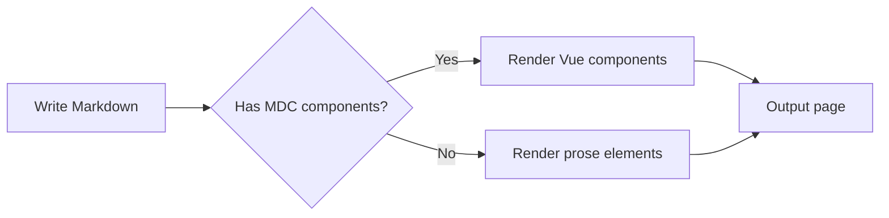
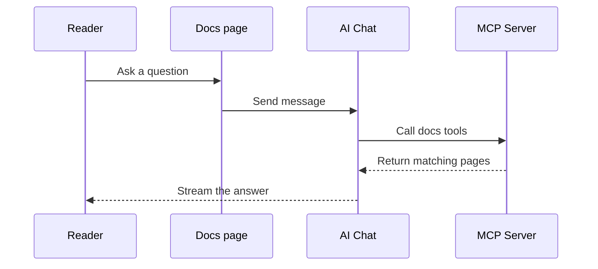
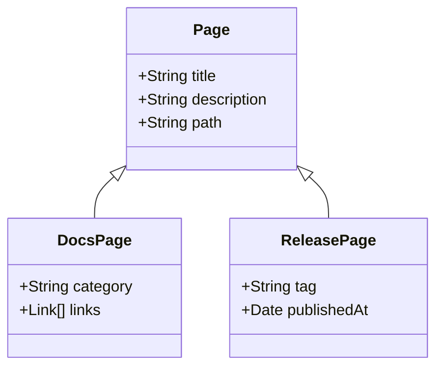
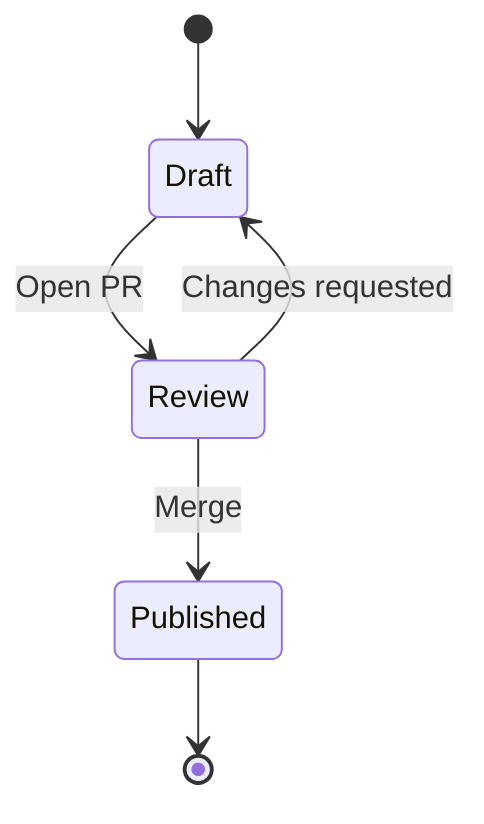
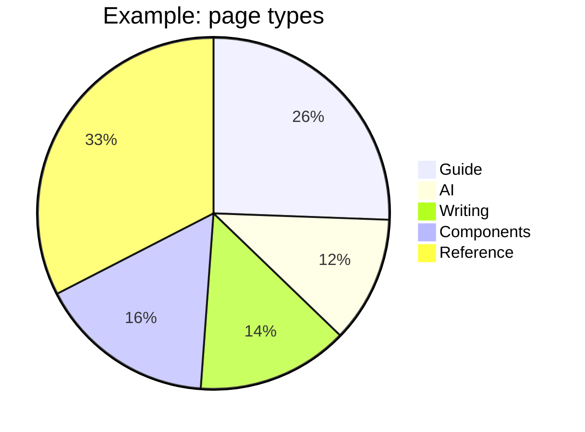
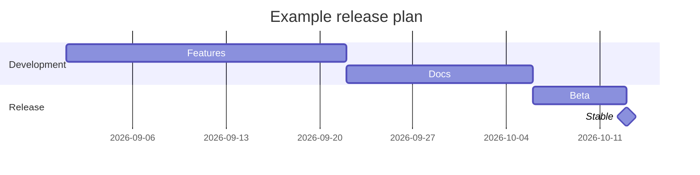
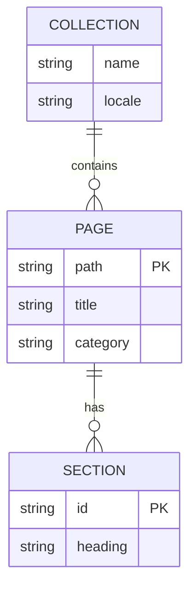

## Enable

Mermaid is disabled by default.

::steps{level="3"}
### Install the dependencies

  ::code-group
  ```bash [pnpm]
  pnpm add mermaid dompurify
  ```

  ```bash [npm]
  npm install mermaid dompurify
  ```

  ```bash [yarn]
  yarn add mermaid dompurify
  ```

  ```bash [bun]
  bun add mermaid dompurify
  ```
  ::

### Turn on the feature flag

```ts [nuxt.config.ts]
export default defineNuxtConfig({
  extends: ['@movk/nuxt-docs'],

  movkNuxtDocs: {
    mermaid: true
  }
})
```
::

::warning{to="/en/docs/guide/features"}
If `mermaid` is enabled without the dependencies installed, the build fails and the error lists the packages to install. When it is disabled, `mermaid` blocks are shown as plain code.
::

## Usage

Write a diagram in a code block with the `mermaid` language:

::code-preview
---
class: "[&>div]:*:my-0 [&>div]:*:w-full"
---


#code
````md

````
::

- Switches the Mermaid theme with the site's color mode
- Loads `mermaid` and renders only once the diagram enters the viewport
- Sanitizes the output with DOMPurify and runs Mermaid with `securityLevel: 'strict'`
- Shows copy and fullscreen buttons in the top-right corner on hover

### Filename

As with regular code blocks, put a filename in square brackets to show it above the diagram:

::code-preview
---
class: "[&>div]:*:my-0 [&>div]:*:w-full"
---


#code
````md
```mermaid [ai-chat.mmd]
sequenceDiagram
    ...
```
````
::

## Diagram types

### Class diagram

`classDiagram` shows types and inheritance:



### State diagram

`stateDiagram-v2` shows state transitions:



### Pie chart

`pie` shows proportions:



### Gantt chart

`gantt` shows schedules and milestones:



### Entity relationship diagram

`erDiagram` shows entities and their relationships:



::tip{to="https://mermaid.js.org/intro/"}
See the Mermaid docs for more diagram types and syntax.
::

## Styling

Override slot classes under `ui.prose.mermaid` in `app/app.config.ts`:

```ts [app/app.config.ts]
export default defineAppConfig({
  ui: {
    prose: {
      mermaid: {
        slots: {
          root: 'my-8 border-primary/40',
          diagram: 'bg-default p-6'
        }
      }
    }
  }
})
```

Default theme:

::code-collapse

```ts [app/app.config.ts]
export default defineAppConfig({
  ui: {
    prose: {
      mermaid: {
        slots: {
          root: 'relative my-5 group border border-muted rounded-md overflow-hidden',
          header: 'flex items-center gap-1.5 border-b border-muted bg-default px-4 py-3',
          filename: 'text-default text-sm/6',
          icon: 'size-4 shrink-0',
          toolbar: 'absolute top-2 right-2 flex gap-1 z-10 opacity-0 group-hover:opacity-100 transition-opacity',
          diagram: 'p-4 flex justify-center bg-elevated overflow-x-auto',
          loading: 'p-4 flex items-center justify-center gap-2 text-sm text-muted',
          error: 'p-4 flex items-center justify-center gap-2 text-sm text-error bg-error/10'
        },
        variants: {
          fullscreen: {
            true: {
              root: 'fixed inset-0 z-50 m-0 rounded-none bg-default flex flex-col',
              diagram: 'flex-1 overflow-auto',
              toolbar: 'opacity-100'
            }
          }
        }
      }
    }
  }
})
```

::

## API

### Props

:component-props{prose name="Mermaid"}

## Changelog

:commit-changelog{commitPath="layer/modules/components/prose" name="Mermaid"}
